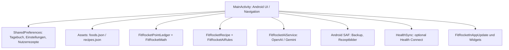

# FitRocket – Architektur und technische Orientierung
Stand: 2026-10-28, Codebasis v0.16.1. Dies ist eine Beschreibung des aktuellen Quellcodes, keine Garantie für getestetes Laufzeitverhalten.

## Systemüberblick
Native Android-Anwendung in Java 17 (minSdk 26, target/compileSdk 35), Gradle Kotlin DSL. Keine zentrale Datenbank und kein eigener Server. Persistenz überwiegend Android SharedPreferences mit JSON-Strings; die Lebensmittel- und Rezeptgrunddaten werden aus gebündelten Assets geladen.

## Verzeichnislandkarte
| Pfad | Verantwortung |
| --- | --- |
| `app/src/main/java/de/inrouder/fitrocket/MainActivity.java` | Monolithische Activity mit Oberflächen, Dialogen, Navigation, Rezeptverwaltung, Import/Export und Activity-Result-Verarbeitung. Vorsicht: große Datei, gezielt ändern. |
| `FitRocketNavigation.java` | Fünf Hauptreiter, Startreiter Tagebuch, Zuordnung von Unterseiten zu Tabs. |
| `FitRocketMath.java` | Grundrechenarten: Nährwertpunkte, Aktivitäts-/Bewegungswerte. |
| `FitRocketPointLedger.java`, `FitRocketWeeklyWallet.java` | Tages-/Wochenkonten und Überträge. |
| `FitRocketRecipe.java` | Rezept-Zutatenverknüpfung und Punkte je Portion auf Basis Katalog. |
| `FitRocketAiRules.java` | Validierung strukturierter KI-Ausgaben und Berechnung ausschließlich durch FitRocket. |
| `FitRocketAiService.java`, `FitRocketAiSecrets.java`, Gemini-API-Klassen | Provider-Anbindung, Antwortverarbeitung, Schlüsselverwaltung. |
| `HealthSync.java` | Optionale Schritte/Trainings von Health Connect. |
| `app/src/main/assets/foods.json` | Mitgelieferte Lebensmittel; ID ist stabiler Verweis. |
| `app/src/main/assets/recipes.json` | Mitgelieferte Rezepte mit Zutaten-IDs. |
| `app/src/main/res/drawable/fitrocket_background_rocket.xml` | Dezentes Raketen-Vektorbild im Hintergrund. |
| `app/build.gradle.kts` | SDK-Versionen, Abhängigkeiten, Version, Signing-Konfiguration. |
| `.github/workflows/android-apk.yml` | Validierung, JUnit, APK-Build, optional signiertes Release. |
| `scripts/validate_catalog.py`, `scripts/validate_ai_schema.py` | Katalog-/Schemaschutz vor Build. |

## Navigation und Darstellung
`MainActivity.shell(heading)` baut Scrollfläche, Seitenüberschrift und die fünfteilige Bottom-Navigation auf. Beim Tagebuch wird der frühere FitRocket-Textheader ausgelassen. Tabs sind als Icon plus getrennte, einzeilige Beschriftung implementiert; Höhen, Inset-Handling, Schrift- und Zeilenabstände gehören zusammen. `FitRocketNavigation.selectedTab` ordnet Unterseiten korrekt zu.
`card(...)`, `shape(...)`, `action(...)` sind wiederverwendete UI-Helfer; Themes über `FitRocketTheme`. Bei Änderungen immer Hell-/Dunkelmodus, 3-Tasten- und Gesten-Navigation, große Systemschrift und schmale Geräte testen.

## Datenfluss Ernährung und Wochenbudget
Mahlzeiten werden in `meals` als JSON-Array persistiert. Eigene Lebensmittel erscheinen in separaten JSON-Listen. Ein gebuchtes Essen beeinflusst Tagesverbrauch und Wochenüberschreitungen. Aktuelle Aktivitäten (Workouts und Schritte) können noch am selben Tag in das Wochenkonto fließen; ungenutzte Tagespunkte werden erst nach Abschluss des Tages übertragen. Der Bewegungsgutschriftanteil ist als Einstellung 0/50/100 % wählbar. Die exakten Regeln stehen in [FORMULAS.md](FORMULAS.md).

## Rezepte und Medien
`loadRecipes()` lädt Assets und ergänzt lokal gespeicherte `savedAiRecipes`. KI-Rezepte speichern strukturierte Zutaten und verknüpfte Lebensmittel; selbst angelegte Rezepte können `manualIngredients` und `manualPoints` enthalten. Nur Daten mit bekannten Nährwerten dürfen automatisch korrekt berechnet werden; manuelle Punkte sind vom Nutzer zu prüfen. `recipeScreen()` listet, `recipeDialog()` bucht, `editOwnRecipe()` editiert und `importRecipeLink()` versucht den Import strukturierter Recipe-JSON-LD-Daten. Bei aktiver KI wird deren bestehende Rezeptanalyse auf erkannte Angaben angewandt. Importierte URLs niemals als zuverlässige Nährwertquelle voraussetzen.
Rezeptfotos werden in `imageData` als komprimiertes JPEG in Base64 abgelegt. Ältere Einträge können noch `imageUri` enthalten; der Backup-Export versucht diese Inhalte einzubetten. Kamera-ACTION_IMAGE_CAPTURE liefert derzeit ein Thumbnail statt garantierter voller Auflösung. Dadurch sind Bildgröße und Qualität begrenzt.

## Backup und Datensicherheit
Export/Import laufen über Android Storage Access Framework und JSON. `savedAiRecipes` ist Bestandteil des Gesamt-Backups, einschließlich eingebetteter Fotos. Externe Bilder, die nicht mehr gelesen werden können, lassen sich nicht retten. JSON ist kein verschlüsseltes Format; Backups können personenbezogene Ernährungsdaten enthalten. API-Schlüssel werden bewusst nicht exportiert. Beim Backup keine absolute Dateipfade als portable Daten speichern. Importgrenzen, Schema-Versionen und Wiederherstellungstests bei Datenformatänderungen anpassen.

## Technische Schulden und Risiken
- `MainActivity` ist sehr groß; UI-, Persistenz- und Netzwerklogik schrittweise in testbare Komponenten auslagern.
- Manuelle Rezeptpunkte sind kein automatischer Nährwertnachweis; freie Textzutaten brauchen strukturiertes Mapping für belastbare Berechnungen.
- JSON-Backups mit Base64-Fotos können sehr groß werden; zukünftig ZIP mit Manifest, Größenlimit und Prüfsummen bevorzugen.
- Externe Rezeptseiten sind unzuverlässig; JSON-LD-Erkennung kann je nach HTML, Redirects und Bot-Schutz scheitern.
- Aktueller Kamera-Intent ist nur Vorschau: für volle Auflösung später FileProvider + EXTRA_OUTPUT und sauberes Lifecycle-Handling ergänzen.
- Release-Build und End-to-End-Tests sind nach Änderungen weiterhin explizit zu prüfen.

## Lebensmittelsuche (v0.16.2)
Die Methode `searchScreen()` gruppiert Textsuche, Barcode-Funktionen, KI-Küchenhelfer und Suchergebnisse in eigenständigen Cards. Barcode-Scan und manuelle Eingabe führen weiterhin zu `scanBarcode()` und `barcodeManualDialog()`; KI-Aktionen rufen `aiCompose("meal")` beziehungsweise `aiCompose("food")` auf. Suchergebnisse werden über den unveränderten `TextWatcher` und die lokale Katalogfilterung erzeugt. Beim UI-Test die Skalierung der Systemschrift und Dark Mode berücksichtigen.

## Kochbuch-Organisation (v0.16.4)
`hiddenStandardRecipes` enthält nur ausgeblendete IDs aus `recipes.json`; das Bundle wird nicht gelöscht. `recipeCategoryOverrides` speichert Kategorien für Standardrezepte, während eigene/AI-Rezepte `cookbookCategory` direkt im Rezeptobjekt halten. Beide zusätzlichen Prefs-Keys gehören zum JSON-Backup; fehlende Keys in Alt-Backups bedeuten keine ausgeblendeten Rezepte und keine Überschreibungen. Die Mahlzeitengruppe (`group`) bleibt für die Buchung unabhängig von der Kochbuch-Kategorie erhalten.

## Löschgeste für persönliche Kochbuchrezepte (v0.16.5)
Nur Rezepte mit IDs `OWN*` und `AIRECIPE*` dürfen über `attachSwipeDelete` und `confirmDeleteOwnRecipe` aus `savedAiRecipes` gelöscht werden; Standardrezepte nutzen weiter `hiddenStandardRecipes`. Nach Bestätigung wird die Liste neu geladen. Bestehende Tagebucheinträge bleiben unangetastet. Im Kochbuch muss die Wischgeste auf verschiedenen Android-Geräten und bei verschachtelten Buttons getestet werden.

## Gewichtsdiagramm (v0.16.6)
`FitRocketWeightChart` rendert offline. Horizontal werden Messpunkte nach tatsächlichem Datum positioniert, nicht nach Listeneintrag-Index. Die vertikale Skala schließt das Zielgewicht ein und berücksichtigt Sicherheitsabstand. Hell/Dunkel nutzen explizite kontrastreiche Farben. Die Kurve verbindet tatsächliche Messwerte ohne Interpolation; bei nur einer Messung wird nur ein Punkt dargestellt. Achsenbeschriftungen, Zielstrich und der jüngste Messpunkt sind gesondert lesbar. Bestehende Daten bleiben unverändert. Bei visuellen Tests auf kleinen Displays und mit großer Systemschrift prüfen.
